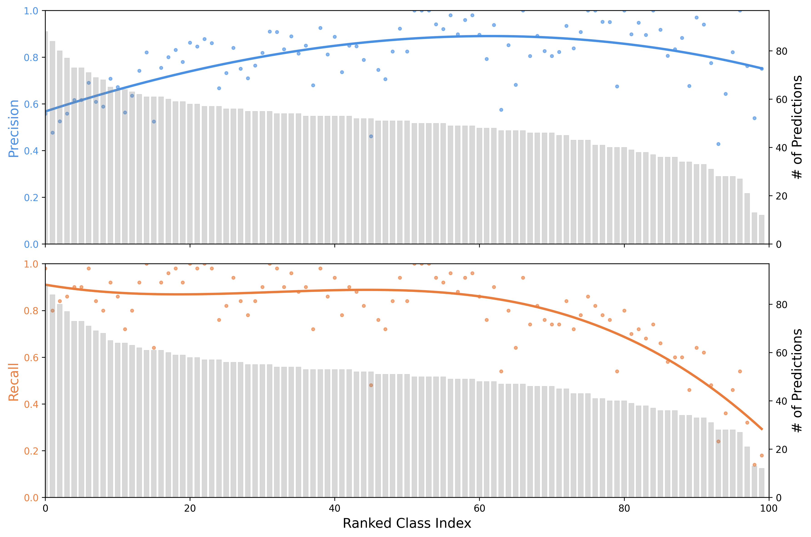
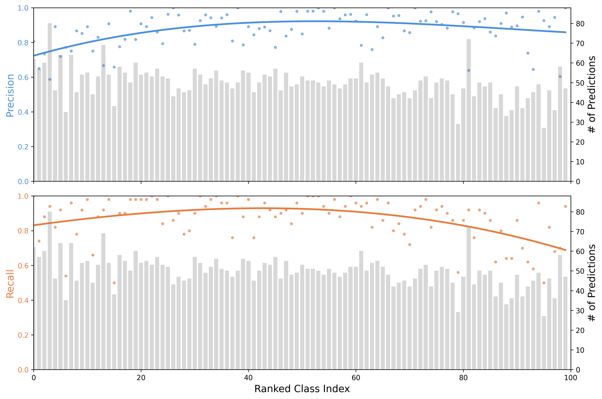

# Debiased Pseudo-Labeling

This repository builds on the official PyTorch implementation of **DebiasPL** ([Debiased Learning from Naturally Imbalanced Pseudo-Labels](https://arxiv.org/abs/2201.01490), Wang et al., CVPR 2022) and adds an evaluation and analysis script, `clip_vs_debiaspl_analysis.py`, that measures how biased a classifier's predictions are on ImageNet-100. It compares zero-shot CLIP (ResNet-50) with a DebiasPL model trained on CLIP pseudo-labels. For each model it reports how often each class is predicted, per-class precision and recall, a frequency-ordered confusion matrix, and cosine similarity between class logit centroids.

The DebiasPL training code (`main_DebiasPL.py`, `main_DebiasPL_ZeroShot.py`, `engine.py`, `models/`, `backbone/`, `data/`, `utils/`, `scripts/`) is upstream code by the paper's authors. See [Acknowledgements](#acknowledgements) for what is upstream and what this repository adds.

## What this repository adds

`clip_vs_debiaspl_analysis.py` is adapted from the upstream `main_DebiasPL(_ZeroShot).py` scripts. It runs inference only, on a single GPU, and has two modes:

- **CLIP zero-shot** (`--clip`): loads OpenAI CLIP `RN50`, encodes the prompt `"a photo of a {class}"` for each of the 100 ImageNet-100 classes, and classifies validation images by the scaled cosine similarity between image and text embeddings.
- **DebiasPL** (`--pretrained <checkpoint>`): builds the upstream `FixMatch` model with a `resnet50_encoder` backbone, loads a DebiasPL checkpoint, and keeps the 100 ImageNet-100 columns of the 1000-way ImageNet logits.

Both modes run the same analysis:

- **Per-class statistics.** True positives, false positives and false negatives are counted per class. Precision and recall are computed from them, and classes are ranked by how often the model predicts them.
- **Precision/recall vs. prediction frequency.** A two-panel plot shows precision (top) and recall (bottom) for each ranked class, with a cubic polynomial trend line, over a histogram of prediction counts.
- **Confusion matrix.** A 100 x 100 annotated heatmap with rows and columns ordered by prediction frequency.
- **Logit centroid similarity.** The script averages the logit vectors of each true class into a centroid, computes the cosine similarity between centroids, and lists the 10 classes closest to the most-predicted and least-predicted classes.
- **Cross-model comparison.** The CLIP run saves its class ordering (`clip_sorted_indices.pkl`) and its most/least predicted classes (`clip_prediction_info.pkl`). The DebiasPL run then plots its results in CLIP's ordering (`debiaspl_precision_recall_clip_order.png`, `debiaspl_confusion_matrix_clip_order.png`) and in its own ordering (`debiaspl_precision_recall.png`). It also re-runs the centroid analysis for CLIP's most/least predicted classes using DebiasPL logits.

`run_clip_zeroshot.sh` and `run_debiaspl_eval.sh` are SLURM batch scripts (1 GPU, 8 CPUs, 1 hour) that run the two modes. The `.log` / `.err` files and the `clip_*.png` / `debiaspl_*.png` figures in the repository root are the outputs of those runs. The logs were recorded before the files were renamed, so they still print the old figure names.

## Results

Both runs evaluate the ImageNet-100 validation split (5,000 images, 100 classes). The numbers come from `fsyang_test33808243.log` (CLIP) and `fsyang_test33808411.log` (DebiasPL).

| Model | Top-1 | Top-5 | Most-predicted class (count) | Least-predicted class (count) |
| --- | --- | --- | --- | --- |
| CLIP RN50, zero-shot | 78.88% | 95.98% | bassinet (88) | hard_disc (12) |
| DebiasPL, ResNet-50 (`debiaspl_zsl_epoch_50.pth.tar`) | 86.96% | 97.66% | American_Staffordshire_terrier (80) | safety_pin (27) |

Observations from the logs and figures:

- **CLIP's predictions are skewed.** Per-class prediction counts range from 12 to 88 for an average of 50. The most-predicted classes have high recall but low precision. For example, bassinet has precision 0.557 and recall 0.980, and English_foxhound has precision 0.476 and recall 0.800.
- **DebiasPL's predictions are more balanced.** Counts range from 27 to 80. CLIP's most-predicted class (bassinet) drops from 88 to 62 predictions, and its least-predicted class (hard_disc) rises from 12 to 47.
- **CLIP's class centroids are hard to tell apart; DebiasPL's are not.** Under CLIP, the 10 classes nearest to bassinet and to hard_disc all have centroid cosine similarity between 0.989 and 0.998. Under DebiasPL, the nearest neighbors are 0.678 (bassinet to rocking_chair) and 0.759 (hard_disc to modem).

| CLIP zero-shot | DebiasPL (same class ordering) |
| --- | --- |
|  |  |

The confusion matrices are in `clip_confusion_matrix.png` and `debiaspl_confusion_matrix_clip_order.png`. The DebiasPL precision/recall plot in its own class ordering is `debiaspl_precision_recall.png`.

## Repository structure

```
.
├── clip_vs_debiaspl_analysis.py              # analysis script added in this repo
├── ANALYSIS.md                               # short setup / run / output reference for the analysis
├── run_clip_zeroshot.sh, run_debiaspl_eval.sh  # SLURM jobs: CLIP run, DebiasPL run
├── fsyang_test*.log / .err                   # stdout / stderr of the two runs
├── clip_*.png, debiaspl_*.png                # figures produced by the analysis script
├── main_DebiasPL.py            # upstream: semi-supervised DebiasPL training
├── main_DebiasPL_ZeroShot.py   # upstream: DebiasPL training from CLIP pseudo-labels
├── engine.py                   # upstream: validation loop
├── models/                     # upstream: FixMatch and MoCo wrappers
├── backbone/                   # upstream: ResNet backbones
├── data/                       # upstream: datasets, transforms, RandAugment
├── utils/                      # upstream: LR schedule, LARS, norm layers, distributed helpers
├── scripts/                    # upstream: training launch scripts
├── requirement.txt
├── LICENSE                     # MIT, Copyright (c) 2022 Xudong Wang
└── DebiasPL.gif, result.png, ZSL-DomainShift.png   # upstream figures
```

## Setup

The runs used Python 3.8 with conda:

```bash
conda create -n debiaspl python=3.8
conda activate debiaspl
pip install -r requirement.txt
pip install git+https://github.com/openai/CLIP.git
```

`requirement.txt` lists `torch`, `torchaudio`, `tensorboard`, `tqdm`, `faiss-gpu` and `pandas`. `clip_vs_debiaspl_analysis.py` also imports `torchvision` and `matplotlib`, which are not in that file, so install them too. A CUDA GPU is required because the script calls `.cuda()` unconditionally.

## Data and checkpoint

- **ImageNet-100.** Pass `--data` a directory that contains a `val/` folder in `torchvision` `ImageFolder` layout, with one sub-folder per class. The 100 classes and their mapping to ImageNet-1k indices are defined in `clip_vs_debiaspl_analysis.py` (`imagenet100_to_name`, `imagenet100_to_1K`).
- **DebiasPL checkpoint.** The DebiasPL run uses `debiaspl_zsl_epoch_50.pth.tar`, the upstream authors' zero-shot DebiasPL ResNet-50 checkpoint, available from [Google Drive](https://drive.google.com/file/d/1UB_9c-2Hr0YVkg_qq24f_D9tsJHT7EjY/view?usp=sharing). The script expects a checkpoint dict with `state_dict` and `epoch` keys. Checkpoints are not committed (`checkpoints`, `pretrained` and `imagenet` are git-ignored).

## Usage

Run the CLIP evaluation first. The DebiasPL run reads the `clip_*.pkl` files that the CLIP run writes. Without them, it prints a warning and uses its own class ordering.

```bash
python clip_vs_debiaspl_analysis.py --clip --data /path/to/imagenet-100
python clip_vs_debiaspl_analysis.py --pretrained debiaspl_zsl_epoch_50.pth.tar --data /path/to/imagenet-100
```

Other flags:

| Flag | Default | Meaning |
| --- | --- | --- |
| `-b`, `--batch-size` | 256 | evaluation batch size |
| `-j`, `--workers` | 8 | data-loading workers |
| `--arch` | `FixMatch` | model wrapper (non-CLIP mode) |
| `--backbone` | `resnet50_encoder` | backbone from `backbone/` |

Outputs written to the working directory: `clip_precision_recall.png`, `clip_confusion_matrix.png`, `clip_prediction_info.pkl` and `clip_sorted_indices.pkl` from the CLIP run, and `debiaspl_precision_recall_clip_order.png`, `debiaspl_precision_recall.png` and `debiaspl_confusion_matrix_clip_order.png` from the DebiasPL run.

On a SLURM cluster, set `IMAGENET100_DIR` (the scripts stop with an error if it is unset), adjust the partition and conda environment name (`debiaspl`) if needed, then submit:

```bash
export IMAGENET100_DIR=/path/to/imagenet-100
sbatch run_clip_zeroshot.sh
sbatch run_debiaspl_eval.sh
```

**Known issue:** in `validate_clip` (`clip_vs_debiaspl_analysis.py`), top-k accuracy is computed with `utils.accuracy(similarity, ...)`, but `similarity` is never defined in the committed file. Pass `logits` instead before running the CLIP mode.

## Upstream DebiasPL training

<p align="center">
  
</p>

DebiasPL builds on FixMatch with EMAN. It keeps an exponential moving average `qhat` of the model's predicted class distribution on unlabeled data and uses it in two places. Pseudo-labels are debiased with logit adjustment (`softmax(logits - tau * log(qhat))`), and an adaptive marginal loss adds `tau * log(qhat)` to the strong-augmentation logits. An optional cross-level instance-group discrimination loss (`--CLDLoss`) further exploits unlabeled data.

The upstream training launch scripts are included. They use multi-GPU distributed training (each script sets `CUDA_VISIBLE_DEVICES`, so adjust it to your machine), a MoCo-EMAN checkpoint at `pretrained/res50_moco_eman_800ep.pth.tar`, and ImageNet at `imagenet/` with `train/`, `val/` and `indexes/*.csv` split files.

```bash
bash scripts/0.2perc-ssl/train_DebiasPL.sh
bash scripts/0.2perc-ssl/train_DebiasPL_w_CLIP.sh
bash scripts/1perc-ssl/train_DebiasPL.sh
bash scripts/1perc-ssl/train_DebiasPL_w_CLIP.sh
bash scripts/zsl/train_DebiasPL_ImageNet.sh
```

See the [upstream repository](https://github.com/frank-xwang/debiased-pseudo-labeling) for the split files, CLIP pseudo-label CSVs, released checkpoints and reported ImageNet-1k results.

<p align="center">
  
  
</p>

## Acknowledgements

- **Upstream code.** The DebiasPL implementation, training scripts, `LICENSE` and the figures `DebiasPL.gif`, `result.png` and `ZSL-DomainShift.png` come from [frank-xwang/debiased-pseudo-labeling](https://github.com/frank-xwang/debiased-pseudo-labeling) by Xudong Wang, Zhirong Wu, Long Lian and Stella X. Yu. The code is released under the MIT License (Copyright (c) 2022 Xudong Wang). Upstream credits parts of its code to [EMAN](https://github.com/amazon-research/exponential-moving-average-normalization), [FixMatch](https://github.com/kekmodel/FixMatch-pytorch), [CLIP](https://github.com/openai/CLIP), [CLD](https://github.com/frank-xwang/CLD-UnsupervisedLearning) and [LA](https://github.com/google-research/google-research/tree/master/logit_adjustment).
- **Added in this repository.** The evaluation and analysis code in `clip_vs_debiaspl_analysis.py` (precision/recall statistics, plots, confusion matrix, centroid similarity and cross-model comparison), the SLURM scripts and the run outputs. The model-loading scaffold in `clip_vs_debiaspl_analysis.py` is derived from the upstream training scripts.
- **CLIP.** Zero-shot classification uses [OpenAI CLIP](https://github.com/openai/CLIP).

If you use DebiasPL, please cite the original paper:

```bibtex
@inproceedings{wang2022debiased,
  title={Debiased Learning from Naturally Imbalanced Pseudo-Labels},
  author={Wang, Xudong and Wu, Zhirong and Lian, Long and Yu, Stella X},
  booktitle={Proceedings of the IEEE/CVF Conference on Computer Vision and Pattern Recognition},
  pages={14647--14657},
  year={2022}
}
```
